# Onetap Marketplace — Database

Status: **PROPOSED ERD (Phase 1) — no migrations run yet.**

## Connection

```env
DB_CONNECTION=mysql
DB_HOST=127.0.0.1
DB_PORT=3306
DB_DATABASE=onetap-shop
DB_USERNAME=root
DB_PASSWORD=
```

Server found: MariaDB 10.11.16 (XAMPP). Database `onetap-shop` already exists (empty). If it ever has
to be recreated:

```sql
CREATE DATABASE `onetap-shop` CHARACTER SET utf8mb4 COLLATE utf8mb4_unicode_ci;
```

## Rules

- Laravel migrations only, incremental. Never `migrate:fresh`, `migrate:reset`, `db:wipe`, drops or truncates without explicit approval.
- Money: `DECIMAL(14,2)`; rates: `DECIMAL(5,2)` (percent). Never float.
- Every FK indexed; `restrictOnDelete` on financial/order links, `cascadeOnDelete` only on pure child rows (images, cart items).
- Soft deletes on users, shops, products (orders reference them historically).
- Snapshots: order items copy product name, variation label, unit price; orders copy the delivery address.
- Status columns are strings backed by PHP enums (portable, readable).
- Tests run on in-memory SQLite (phpunit.xml) — they never touch `onetap-shop`.

## ERD

```mermaid
erDiagram
    users ||--o{ user_roles : has
    roles ||--o{ user_roles : grants
    roles ||--o{ role_permissions : has
    permissions ||--o{ role_permissions : in
    users ||--o| customer_profiles : has
    users ||--o| seller_profiles : has
    users ||--o| rider_profiles : has
    users ||--o{ user_addresses : has
    users ||--o{ verification_documents : uploads

    seller_profiles ||--|| shops : owns
    shop_categories ||--o{ shops : classifies
    shops ||--o{ products : sells
    product_categories ||--o{ products : classifies
    product_categories ||--o{ product_categories : parent
    products ||--o{ product_images : has
    products ||--o{ product_variations : has
    product_variations ||--o{ product_inventory : ledger
    products ||--o{ product_reviews : receives
    products ||--o{ product_violations : flagged
    shops ||--o{ vouchers : issues

    users ||--|| shopping_carts : has
    shopping_carts ||--o{ cart_items : contains
    product_variations ||--o{ cart_items : selected

    users ||--o{ orders : places
    orders ||--|| order_addresses : ships_to
    orders ||--o{ seller_orders : split_into
    shops ||--o{ seller_orders : fulfils
    seller_orders ||--o{ order_items : contains
    product_variations ||--o{ order_items : sold
    seller_orders ||--o{ order_status_histories : logs
    orders ||--o{ payments : paid_by
    seller_orders ||--o{ refunds : may_have
    order_items ||--o| product_reviews : reviewed

    logistics_partners ||--o{ service_areas : covers
    logistics_partners ||--o{ rider_profiles : employs
    logistics_partners ||--o{ shipments : handles
    seller_orders ||--|| shipments : shipped_as
    shipments ||--o{ shipment_items : contains
    shipments ||--o{ shipment_status_histories : logs
    shipments ||--o{ delivery_assignments : assigned
    rider_profiles ||--o{ delivery_assignments : receives
    shipments ||--o| delivery_proofs : proven_by

    seller_orders ||--o| commissions : charges
    users ||--o{ transactions : ledger
    shops ||--|| seller_balances : has
    shops ||--o{ bank_accounts : has
    shops ||--o{ withdrawals : requests
    shipments ||--o| rider_collections : cod
    rider_profiles ||--o{ rider_collections : collects
    rider_profiles ||--o{ rider_remittances : remits
    rider_remittances ||--o{ rider_collections : settles

    conversations ||--o{ conversation_participants : has
    users ||--o{ conversation_participants : joins
    conversations ||--o{ messages : has
    users ||--o{ notifications : receives
    users ||--o{ audit_logs : performs
```



## Tables

`id`, `created_at`, `updated_at` are implied on every table.

### Identity
| Table | Key columns |
| --- | --- |
| users *(existing; extended)* | name, username (uniq), email (uniq), phone (uniq null), password, profile_picture, status [active/pending/suspended], suspended_at, suspension_reason, last_login_at, email_verified_at, deleted_at. Existing `role` column kept for backward-compat, superseded by `user_roles` |
| roles | name (uniq: admin, customer, seller, logistics, rider), label |
| permissions | name (uniq e.g. `products.approve`), label, group |
| user_roles | user_id FK, role_id FK, uniq(user_id, role_id) |
| role_permissions | role_id FK, permission_id FK, uniq |
| customer_profiles | user_id FK uniq, birthdate, gender, referral_code uniq, referred_by FK users |
| seller_profiles | user_id FK uniq, business_name, business_type, tin, status [pending/approved/rejected/suspended], rejection_reason, approved_at, approved_by FK |
| rider_profiles | user_id FK uniq, logistics_partner_id FK, vehicle_type, plate_number, license_number, status [pending/active/suspended], availability [offline/available/busy], last_lat, last_lng, last_seen_at |
| user_addresses | user_id FK, label, recipient_name, phone, region, province, city, barangay, street, postal_code, lat, lng, is_default |
| verification_documents | user_id FK, type, path (private disk), status, reviewed_by FK, reviewed_at, notes |

### Catalog
| Table | Key columns |
| --- | --- |
| shop_categories | name, slug uniq |
| shops | seller_profile_id FK uniq, shop_category_id FK, name, slug uniq, description, logo, banner, template, decoration (json), pickup address fields + city/barangay, status [pending/active/suspended/closed], vacation_mode bool, vacation_message, rating_avg DECIMAL(3,2), deleted_at |
| product_categories | parent_id FK self, name, slug uniq, icon, sort_order, is_active |
| products | shop_id FK, product_category_id FK, name, slug uniq, description, brand, status [draft/under_review/live/rejected/violation/unpublished], rejection_reason, base_price, weight_grams, sold_count, rating_avg, rating_count, published_at, deleted_at; idx(status), fulltext(name, description) |
| product_images | product_id FK cascade, path, sort_order, is_primary |
| product_variations | product_id FK cascade, sku uniq, label ("Red / M"), options json, price, compare_at_price, stock (current on-hand), reserved, is_default, is_active |
| product_inventory | product_variation_id FK, type [restock/sale/reserve/release/adjustment/return], quantity (signed int), balance_after, reference_type, reference_id, user_id FK — append-only stock ledger |
| product_reviews | product_id FK, order_item_id FK uniq, user_id FK, rating tinyint, comment, images json, seller_reply, replied_at, is_visible |
| product_violations | product_id FK, reported_by FK, reason, details, status [open/resolved], resolved_by FK |
| vouchers | shop_id FK null (null = platform voucher), code uniq, type [fixed/percent/free_shipping], value, min_spend, max_discount, usage_limit, per_user_limit, used_count, starts_at, ends_at, is_active |
| voucher_redemptions | voucher_id FK, user_id FK, order_id FK, amount |
| promotions | shop_id FK, name, discount_percent, starts_at, ends_at; promotion_products pivot |

### Ordering
| Table | Key columns |
| --- | --- |
| shopping_carts | user_id FK uniq |
| cart_items | shopping_cart_id FK cascade, product_variation_id FK, quantity, is_selected; uniq(cart, variation) |
| orders | order_number uniq, user_id FK, payment_method, payment_status, items_subtotal, shipping_total, discount_total, grand_total, voucher_id FK null, notes, placed_at |
| order_addresses | order_id FK uniq, snapshot of recipient/phone/region/province/city/barangay/street/postal/lat/lng |
| seller_orders | order_id FK, shop_id FK, reference uniq, status, items_subtotal, shipping_fee, discount, total, commission_rate, commission_amount, seller_earning, cancelled_reason, cancelled_by, paid_at, shipped_at, delivered_at, completed_at, cancelled_at; idx(shop_id, status) |
| order_items | seller_order_id FK, product_id FK, product_variation_id FK, product_name, variation_label, unit_price, quantity, line_total |
| order_status_histories | seller_order_id FK, from_status, to_status, note, user_id FK null |
| payments | order_id FK, method [cod/gcash/maya/card], provider, provider_ref, amount, status [pending/paid/failed/refunded], paid_at |
| refunds | seller_order_id FK, user_id FK, reason, details, evidence json, amount, status [requested/approved/rejected/refunded], resolved_by FK, resolved_at |

### Logistics
| Table | Key columns |
| --- | --- |
| logistics_partners | user_id FK (owner/admin account), name, code uniq, contact_phone, contact_email, base_delivery_fee, status |
| service_areas | logistics_partner_id FK, region, province, city, barangay null (null = whole city), delivery_fee override, is_active; uniq(partner, city, barangay) |
| shipments | tracking_number uniq, seller_order_id FK uniq, logistics_partner_id FK, status, pickup address snapshot, dropoff address snapshot, cod_amount, delivery_fee, attempts, scheduled_at, picked_up_at, delivered_at |
| shipment_items | shipment_id FK, order_item_id FK, quantity |
| shipment_status_histories | shipment_id FK, from_status, to_status, note, lat, lng, user_id FK |
| delivery_assignments | shipment_id FK, rider_profile_id FK, type [pickup/delivery/return], status [assigned/accepted/declined/completed/cancelled], assigned_by FK, accepted_at, completed_at |
| delivery_proofs | shipment_id FK uniq, rider_profile_id FK, photo_path (private), recipient_name, recipient_relation, signature_path null, lat, lng, delivered_at |

### Finance
| Table | Key columns |
| --- | --- |
| commissions | seller_order_id FK uniq, rate, base_amount, amount |
| transactions | user_id FK null, shop_id FK null, logistics_partner_id FK null, type [sale_earning/commission/delivery_fee/withdrawal/refund/adjustment/cod_collection/remittance], direction [credit/debit], amount, balance_after, reference_type, reference_id, description — append-only ledger |
| seller_balances | shop_id FK uniq, pending_balance, available_balance, total_earned, total_withdrawn |
| bank_accounts | shop_id FK, bank_name, account_name, account_number (encrypted cast), is_default |
| withdrawals | shop_id FK, bank_account_id FK, amount, fee, status [pending/approved/paid/rejected], processed_by FK, processed_at, reference |
| rider_collections | shipment_id FK uniq, rider_profile_id FK, amount_due, amount_collected, collected_at, rider_remittance_id FK null, status [collected/remitted/discrepancy] |
| rider_remittances | rider_profile_id FK, logistics_partner_id FK, remittance_date, expected_amount, remitted_amount, discrepancy, status [submitted/confirmed/disputed], confirmed_by FK, confirmed_at |

### Communication
| Table | Key columns |
| --- | --- |
| conversations | shop_id FK null, type [customer_shop/support], last_message_at |
| conversation_participants | conversation_id FK, user_id FK, last_read_at; uniq |
| messages | conversation_id FK, user_id FK, body, attachment_path, is_auto_reply |
| shop_auto_replies | shop_id FK, type [greeting/keyword/offline], keyword, message, is_active |
| notifications | Laravel standard (uuid id, type, notifiable morph, data json, read_at) |

### Administration
| Table | Key columns |
| --- | --- |
| audit_logs | user_id FK null, action, auditable_type, auditable_id, old_values json, new_values json, ip_address, user_agent |
| system_settings | group, key uniq(group,key), value text/json, is_public |
| banners | title, image, link_url, position, sort_order, starts_at, ends_at, is_active |

## Migration log

| Date | Migration | Notes |
| --- | --- | --- |
| 2026-11-15 | `0001_01_01_*` (starter) | users, password_reset_tokens, sessions, cache, jobs |
| 2026-11-15 | `2026_11_15_100000_extend_users_table` | users: phone, status, suspended_at, suspension_reason, last_login_at, deleted_at |
| 2026-11-15 | `2026_11_15_100100` → `101000` | RBAC, logistics partners, profiles, catalog, marketing, ordering, shipments, finance, communication, administration (every table above) |
| 2026-11-15 | `2026_11_15_133215_create_personal_access_tokens_table` | Sanctum |

All in batch 1 on `onetap-shop` (63 tables). Additions from the table list above: `promotion_products`, `voucher_redemptions`, `shop_auto_replies`, `banners`, and `bank_accounts.account_last4` (the full number is stored with an encrypted cast).
